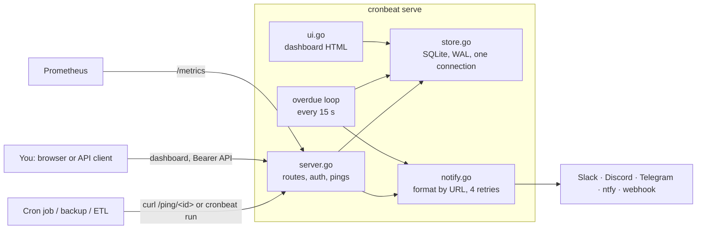
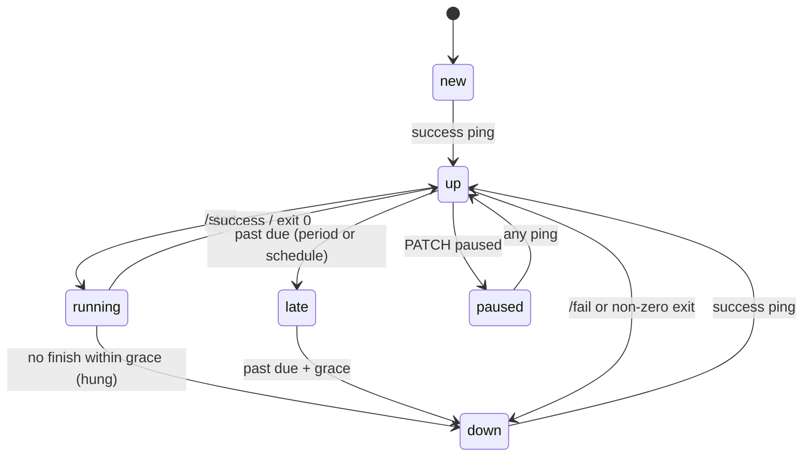

# cronbeat architecture

One static Go binary with SQLite inside (pure Go, no cgo), about 2,000 lines. It serves pings, a JSON API, Prometheus
metrics and a small server-rendered dashboard, and checks every 15 seconds for jobs that missed their deadline.

| File | Owns |
|---|---|
| `main.go` | commands (`serve`, `run`, `version`), configuration, the overdue loop, graceful shutdown |
| `server.go` | routes; ping handling and state transitions; the JSON API with bearer auth (constant-time compare); metrics; the dashboard session |
| `store.go` | the schema and migrations; checks, pings (last 100 per check, bodies capped at 10 KB); `MarkOverdue` |
| `schedule.go` | cron expressions (`robfig/cron`) with IANA time zones; next fire time after the last ping |
| `notify.go` | alert formats per URL, retries with back-off, 10 s timeouts |
| `ui.go` | the dashboard: server-rendered HTML, no JavaScript framework |
| `run.go` | `cronbeat run`: wraps a job (start ping, output tail, exit code, signals) |

## A check's life

- **Deadlines:** each ping stores the time the check goes down (`deadline_ms`): last ping + period + grace, or, with a
  `schedule`, the next fire time after the last ping + grace, in the check's time zone (daylight saving handled).
- **The overdue loop** (`--check-interval`, default 15 s) flips checks past their deadline, or started and not finished
  within grace, to `down` in one guarded `UPDATE` (the same condition as the `SELECT`, so a ping landing in between
  can't be overwritten) and sends one alert each.
- **Alerts fire on transitions only:** once down, once back up. `late` is shown, never alerted.

## Data
SQLite in WAL mode, one connection (SQLite has one writer; this keeps writes serialised), foreign keys on.
| Table | Holds |
|---|---|
| `checks` | id (UUID), name, period/schedule/tz/grace, status, paused, alert URLs, last ping/start/duration, deadline, created |
| `pings` | check id, kind (success, start, fail), exit code, time, remote address, output (≤10 KB); the last 100 per check |
| `settings` | the generated API key |

Migrations run at start-up (`ALTER TABLE … ADD COLUMN` when a column is missing), so upgrades are in place.

## Security
- **Pings need no auth:** the check's random UUID is the secret (like Healthchecks.io). Treat ping URLs as credentials.
- **The API and metrics** need the bearer key (constant-time compare). The key is generated on first start and stored
  in `settings`, or set with `CRONBEAT_API_KEY`.
- **The dashboard** logs in with the same key and keeps a cookie derived from it (an HMAC): changing the key signs every
  browser out.
- **`remote` on a ping** is informational: behind a proxy it's the first `X-Forwarded-For` entry, which a client can set.
- Put TLS in front (Caddy); bind cronbeat to `127.0.0.1`.

## Key decisions
| Decision | Why |
|---|---|
| One binary, SQLite, no external services | a 5-minute self-host; a small VPS is plenty |
| Pure-Go SQLite (`modernc.org/sqlite`) | static binaries for every platform, no cgo |
| Alerts on transitions only | no alert storms; the dashboard shows the rest |
| Hang detection via `/start` + grace | catches jobs that start and never finish, the failure cron hides best |
| AGPL-3.0 | self-hosting stays free; anyone offering a modified version as a service shares their changes |
